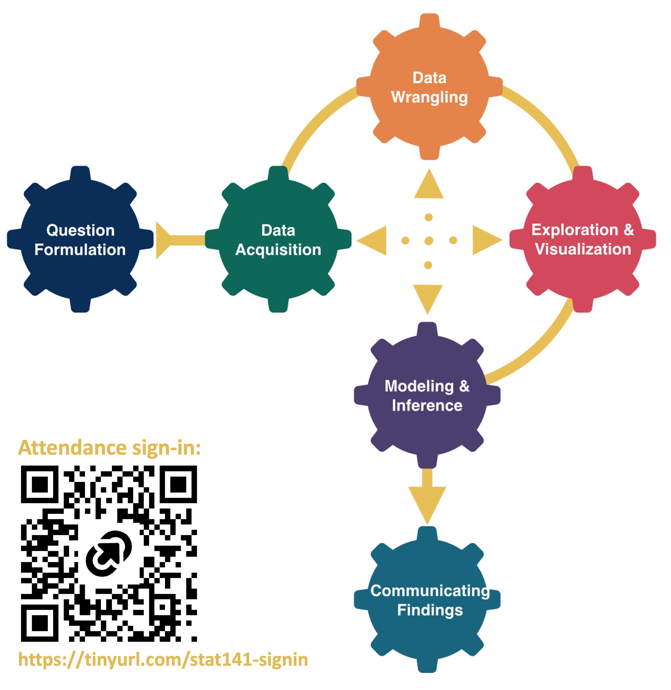
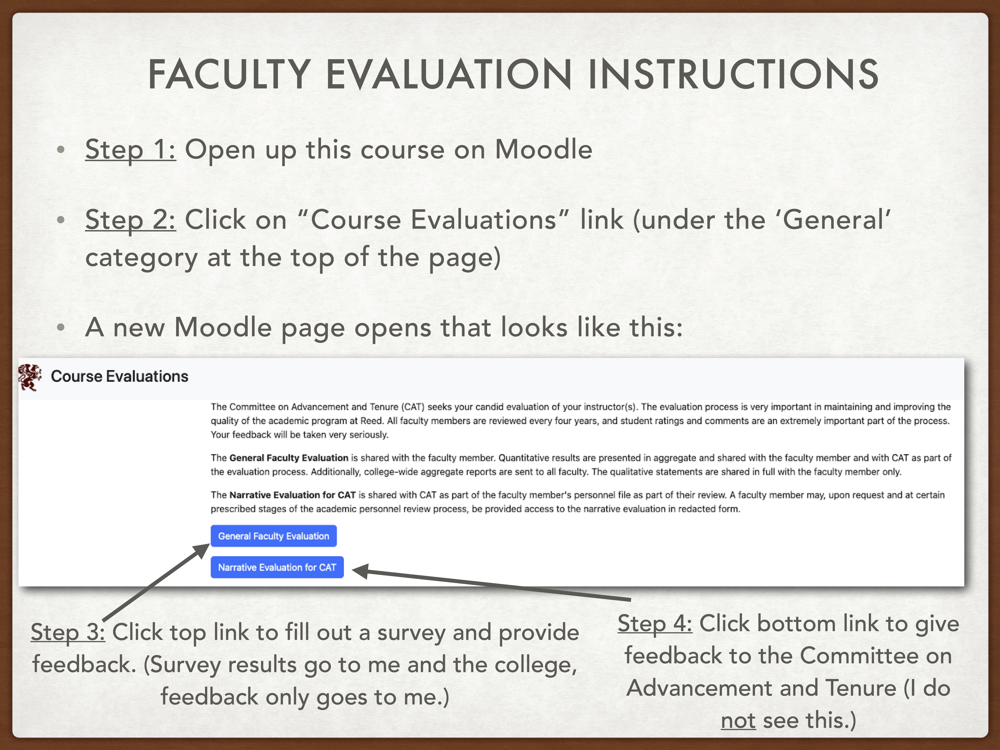
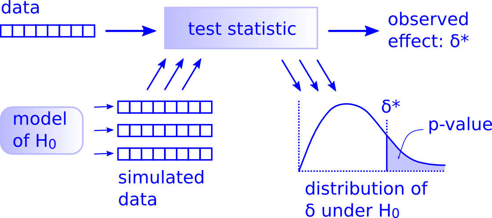

```{r include=FALSE}
knitr::opts_chunk$set(echo = F, message = FALSE, warning = FALSE, fig.align = "center", fig.height = 4, fig.width = 6,  out.width = "75%")
options(digits = 3)
library(knitr)
library(tidyverse)
library(dplyr)
library(ggthemes)
library(moderndive)
library(gapminder)
library(infer)
library(tufte)
library(gridExtra)
library(kableExtra)

theme_set(theme_bw())
theses<-read_csv("Data/theses.csv") %>% 
  filter(division %in% c("ART","HSS","LL","MNS","PRPL")) %>% 
  drop_na(n_pages, year)

library(palmerpenguins)
penguins <- penguins %>% drop_na()
set.seed(4)
penguins <- penguins[sample(1:333,100),]
penguins$species <- factor(penguins$species,levels=c("Chinstrap","Gentoo","Adelie"))
```

::::: columns
::: {.column .center width="50%"}
{width="90%"}
:::

::: {.column .center width="50%"}
<br>

[The Big Picture]{.custom-title}

<br> <br> 

[Megan Ayers]{.custom-subtitle}

[Stat 141 \| Fall 2026 <br> Monday, Week 15]{.custom-subtitle}
:::
:::::


------------------------------------------------------------------------

## Announcements/Reminders

- Tuesday has become Thursday

- Reading week office hours

- Note card for exam

------------------------------------------------------------------------

## Goals for today

- Course evaluations

- "There is only one test" 

- Reflect on the big picture of learning from data using probability, statistics, and `R`


# Course Evaluations

------------------------------------------------------------------------

{width=75% fig-align="center"}

```{r}
#| echo: false
countdown::countdown(15)
```

------------------------------------------------------------------------

### "There is only one test"

<br>


{width=120%}


------------------------------------------------------------------------

## Learning Outcomes

:::: {.columns}

::: {.column width="55%"}


:::


::: {.column width="45%"}

<br><br><br>

- Think back to your week 1 self

- Since then, we've learned skills to work with data, draw conclusions from data, and critically engage in the entire data analysis process!

:::

::::

------------------------------------------------------------------------

## Learning Outcomes

:::: {.columns}

::: {.column width="55%"}


:::


::: {.column width="45%"}

**Exploration & Visualization**

Over the semester we've learned how to...

::: {.fragment .nonincremental}

- Recognize common data structures in R
- Create beautiful and effective graphs with `ggplot`!
- Use visualizations to gain insights from data
- Critically interpret visualizations

:::

:::

::::

------------------------------------------------------------------------

## Learning Outcomes

:::: {.columns}

::: {.column width="55%"}


:::


::: {.column width="45%"}

**Data Wrangling**

Over the semester we've learned how to...

::: {.fragment .nonincremental}

- Perform data wrangling operations in `R`
- Calculate statistics from data
- Resample data to create bootstrap, null, sampling distributions

:::

:::

::::


------------------------------------------------------------------------

## Learning Outcomes

:::: {.columns}

::: {.column width="55%"}


:::


::: {.column width="45%"}

**Data Acquisition**

Over the semester we've learned how to...

::: {.fragment .nonincremental}

- Determine the data and study conditions necessary to conduct different analyses
- Critically consider where our data comes from
- Consider sampling strategies and study design when interpreting results

:::

:::

::::


------------------------------------------------------------------------

## Learning Outcomes

:::: {.columns}

::: {.column width="55%"}


:::


::: {.column width="45%"}

**Modeling & Inference**

Over the semester we've learned how to...

::: {.fragment .nonincremental}

- Build linear regression models and determine when they are appropriate
- Perform simulation-based inference with hypothesis testing and confidence intervals
- Use probability theory to perform theory-based inference tasks

:::

:::

::::


------------------------------------------------------------------------

## Learning Outcomes

:::: {.columns}

::: {.column width="55%"}


:::


::: {.column width="45%"}

**Question Formulation**

Over the semester we've learned how to...

::: {.fragment .nonincremental}

- Translate research questions into testable hypotheses involving parameters and statistics
- Use exploratory data analysis to generate new research questions
- Identify the questions our data and analyses can, and cannot, answer

:::

:::

::::


------------------------------------------------------------------------

## Learning Outcomes

:::: {.columns}

::: {.column width="55%"}


:::


::: {.column width="45%"}

**Communicating Findings**

Over the semester we've learned how to...

::: {.fragment .nonincremental}

- Work with Quarto documents (`.qmd` files) to develop a reproducible workflow
- Interpret and communicate the results of statistical analyses effectively
- Use graphs to communicate findings visually 

:::

:::

::::

------------------------------------------------------------------------

## Statistical Thinking

::: {.nonincremental}

- Software like `R` makes it incredibly easy to perform statistical analyses and tests and abstract away the details.

```{r eval = F, echo = T}
t.test(response ~ group, data = df)  # Inference for difference-in-means
```

:::

<br>

- There is deep theory, and, strong assumptions about the underlying data behind one-liners like this. In this course we've discussed:
    - Tools to understand the underlying **probability theory** being employed
    - The **conditions** required for tests and analyses to be valid, and **how we can check them** using data wrangling, visualization, and context on the data collection process
    - **Simulation-based methods as alternatives** when some conditions aren't met
    - How to **responsibly interpret p-values** and what kinds of conclusions are reasonable given the data context


